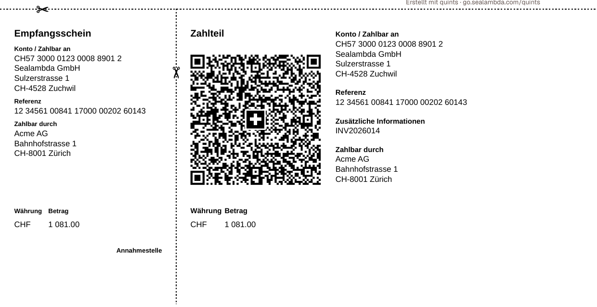
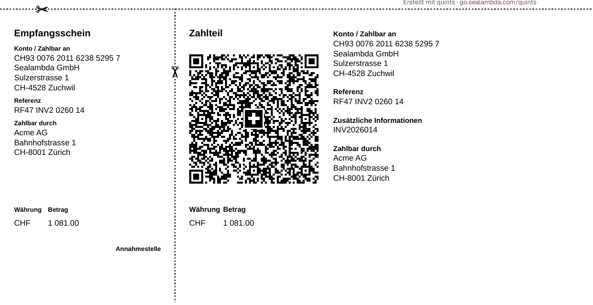

# Payment references

Every invoice quints renders asks to be paid with a **structured reference**
derived from its number. The payment then carries its own invoice id, and
`quints import` and `quints match` credit it to the right invoice instead of
guessing from the amount.

Switzerland has two such references, each tied to a kind of bank account.
The wrong pair is a QR-bill banks reject. quints picks QRR when your account
can carry it and SCOR otherwise, or SCOR when you ask for it.

!!! abstract "Applies if"
    - **Legal form and VAT status:** any. References don't depend on either.
    - **Invoices:** Swiss QR-bills in CHF or EUR, and export invoices
      (SEPA/SWIFT). The choice is per bank account in
      `invoicing/issuer.yaml`.

## The three reference types

The Swiss QR-bill defines three, in the `Tp` element of the QR code:[^ig]

| Type | Looks like | Account it needs | Currencies |
|---|---|---|---|
| **QRR** — QR reference | `12 34561 00841 17000 00202 60143` | QR-IBAN **only** | **CHF only** |
| **SCOR** — Creditor Reference (ISO 11649) | `RF47 INV2 0260 14` | regular IBAN **only** | CHF and EUR |
| **NON** — no reference | *(empty)* | regular IBAN | CHF and EUR |

The pairing is a rule of the standard, not a convention:

> Must contain the code QRR where a QR-IBAN is used; where the IBAN is used,
> either the SCOR or NON code can be entered.

and, for the QR reference and the QR-IBAN:

> [The QR reference] can only be used in combination with a QR-IBAN … [and]
> for invoicing in CHF. … The reference must not consist exclusively of zeros.
>
> [The QR-IBAN] can only be used for invoicing and payments in CHF.

So **QR-IBAN + SCOR**, **IBAN + QRR** and **QR-IBAN in EUR** are invalid.
quints resolves the valid pair from your account, and refuses a setting that
breaks the rule instead of substituting another.

## Side by side

The same invoice under each scheme. With a QR-IBAN and the bank's
identification, the QR reference ends in the invoice's own digits:



With the regular IBAN, the creditor reference spells the invoice number out:



## A QR-IBAN is a second account number

A QR-IBAN is not your IBAN written differently. It is a separate number your
bank issues you, with an institution id in the **30000–31999** range:

```text
IBAN      CH93 0076 2011 6238 5295 7
QR-IBAN   CH57 3000 0123 0008 8901 2
               ^^^^^ 30000 — the QR-IID
```

Every bank in the scheme owns exactly one QR-IID, listed in SIX's bank
master (PostFinance 30000, UBS 30005, Raiffeisen 30808, …), and validators
check against that list. The Guidelines' sample QR-IBAN,
`CH44 3199 9123 0008 8901 2`, sits on 31999, which no bank owns: UBS's
QR-bill portal answers it with "Please correct the QR IID". quints' samples
carry PostFinance's 30000 instead, on an account number that belongs to
nobody.

Both numbers can point at the same account, but a QR-IBAN cannot receive an
ordinary credit transfer. A payment from abroad needs the regular IBAN: an
export invoice always carries SCOR, and you keep `iban` next to `qr_iban`.

## Which one should you use?

**QRR with a QR-IBAN, if your bank gives you one.** It is the successor of
the orange ESR/BVR payment slip, the scheme Swiss accounts-payable
departments and e-banking apps are built around. quints uses it as soon as
the account has a `qr_iban`.

- **For:** the payer's bank **refuses any payment to a QR-IBAN without a
  valid QR reference**. It cannot be forgotten, mistyped or left off a
  manual transfer, so every payment that reaches you is matchable.
- **Against:** it is numeric (quints keeps your invoice's digits visible,
  see [below](#what-the-qr-reference-contains)), CHF-only, and limited to
  Switzerland and Liechtenstein. It needs the QR-IBAN and a six-digit
  identification from your bank.

**SCOR with your regular IBAN, when you have no QR-IBAN or want one readable
reference everywhere.** quints uses it for every account without a
`qr_iban`, every QR-bill in EUR and every export invoice.

- **For:** it works with the account number you already have, is valid on a
  QR-bill in CHF and EUR, and travels in SEPA transfers, so a foreign
  customer quotes the same reference as a domestic one. It spells out the
  invoice number: `RF47 INV2 0260 14` is readable on a statement and
  quotable in a reminder.
- **Against:** on a regular IBAN the reference is optional for the payer. A
  transfer typed by hand can arrive with an amount and a name only; quints
  then scores by payee and amount and asks you to confirm.

**Prefer SCOR although you have a QR-IBAN?** Set `reference: scor` on the
account. The QR-IBAN stays on file, unused; QR-bills go out with RF
references paid into the regular `iban`.

## What the QR reference contains

A QR reference is 26 digits plus a check digit, with no letters. quints
encodes the invoice number into it so that it stays recognisable on a
statement:

```text
INV2026014, bank id 123456 →  12 34561 00841 17000 00202 60143
                              ^^^^^^ ^ ^^^^^^^ ^^^^^^^^^^^^ ^
                              bank id | letters      digits  check digit
                                      form
```

- The first six digits are the identification your bank assigned you
  (`qr_reference_id`; zeros if you have not configured one).
- One digit names the form. `1` is the legible form for the usual shape of
  invoice number, up to four letters then digits: a block holding the
  letters, then the digits themselves, right-aligned, so the reference ends
  in `…2026014`.
- `2` is the fallback for any other shape (`ACAD202608B`), an opaque
  bijective-base-36 encoding.
- The last digit is the modulo-10 check digit every QR reference carries.

Both forms are injective: `INV0042` and `INV42` never share a reference.
Both decode: `quints import` and `quints match` turn a QR reference from a
bank statement back into the invoice number without needing your bank id.

- **Case and punctuation are not carried**, in QRR or SCOR: `INV-014` and
  `INV014` would share a reference. Keep numbers distinct in their letters
  and digits.
- **Length:** a QR reference carries at most twelve letters and digits, a
  SCOR reference 21. A longer invoice number is refused at load, not
  truncated: a truncated reference is a payment credited to somebody else's
  invoice.

## Configuring it

The scheme is set per currency in `invoicing/issuer.yaml`. An account with
only a regular `iban` pays by SCOR, with nothing to declare:

```yaml
bank:
  CHF:
    iban: CH93 0076 2011 6238 5295 7
    bic: POFICHBEXXX
    bank_name: PostFinance AG, Bern
  EUR:
    iban: DE89 3704 0044 0532 0130 00
    bic: COBADEFFXXX
```

Add the QR-IBAN, and CHF QR-bills switch to QRR, paid into it. Add the
six-digit identification your bank assigns you too (UBS calls it the
**BESR-ID**): banks require it as the first six digits of every reference.
Without it your references start `000000`.

```yaml
bank:
  CHF:
    qr_iban: CH57 3000 0123 0008 8901 2
    qr_reference_id: "123456"   # quoted — YAML reads a bare leading zero as octal
    iban: CH93 0076 2011 6238 5295 7   # keep it: CHF from abroad needs it
    bic: POFICHBEXXX
```

To keep the QR-IBAN on file but issue RF references anyway:

```yaml
bank:
  CHF:
    reference: scor
    qr_iban: CH57 3000 0123 0008 8901 2
    iban: CH93 0076 2011 6238 5295 7
```

`reference: qrr` means the same as leaving it out on an account that has a
`qr_iban`. On an account that has none, or on a QR-bill in EUR, it is an
error instead of a fallback.

## How quints resolves it

| Account has | Invoice | Reference |
|---|---|---|
| `iban` only | domestic | SCOR, into `iban` |
| `qr_iban`, with or without `iban` | domestic, CHF | QRR, into `qr_iban` |
| `qr_iban` and `iban` | domestic, EUR | SCOR, into `iban` — the QR scheme is CHF-only |
| `qr_iban` only | domestic, EUR | **error** — add an `iban` |
| `reference: scor` | domestic | SCOR, into `iban` (error if there is none) |
| `reference: qrr` | domestic, CHF | QRR, into `qr_iban` (error if there is none) |
| `reference: qrr` | domestic, EUR | **error** — CHF only |
| any | export | SCOR (a credit transfer has no QR-bill) |

`quints invoice` prints what it used on every render:

```text
ref QRR 12 34561 00841 17000 00202 60143
```

`quints invoice … --json` carries it as `reference` and `reference_type`.

## Checking an account before it ships

```bash
quints iban
```

It checks every IBAN and BIC in the issuer config (length, national layout,
mod-97 check digits, ISO 9362) and exits non-zero when something is off. It
reports the institution behind Swiss and Liechtenstein IBANs, so you see
whether a `qr_iban` really carries a QR-IID (30000–31999).

## Overriding a single invoice

Set `reference:` on the *invoice* only to re-issue one that went out with a
reference produced elsewhere:

```yaml
number: INV2026014
reference: RF47INV2026014
```

It is validated by its check digits at load, and refused if it doesn't
match the scheme the account resolves to: a QR reference cannot go on an
account that pays by SCOR.

## When the payment comes back

`quints import` and `quints match` read the references out of a payment's
details:

- QR references however the bank groups them, with or without their leading
  zeros;
- RF references with or without spaces;
- the plain invoice number as a whole word.

They verify the check digits, decode a QR reference into its invoice
number, and match **exactly**, never by substring: a payment for
`ACAD202608B` is never credited to `ACAD202608`. Invoices issued with the
old zero-padded reference still clear. A reference that fits more than one
open invoice matches nothing: the draft stays flagged `!` and `quints match`
says why. See [Import statements](importing.md).

## What quints doesn't do here

- **Issue a QR-bill without a reference (NON).** The standard allows it,
  but `quints match` relies on every invoice carrying one. A bill without
  would come back as an amount and a date.

[^ig]: [Swiss Implementation Guidelines QR-bill](https://www.six-group.com/en/products-services/banking-services/payment-standardization/standards/qr-bill.html), sections 2.10 (QR-IBAN), 2.12.1 (QR reference), 2.12.2 (Creditor Reference) and the `RmtInf/Tp`, `RmtInf/Ref` data elements. Version 2.4 (24 February 2026) is valid from 14 November 2026 and replaces version 2.3 of 21 November 2025, which stays valid until November 2027. The one difference that matters here: from 2.4 a QR-bill in EUR can only be IBAN + SCOR or IBAN + unstructured message — the QR scheme is CHF-only.
