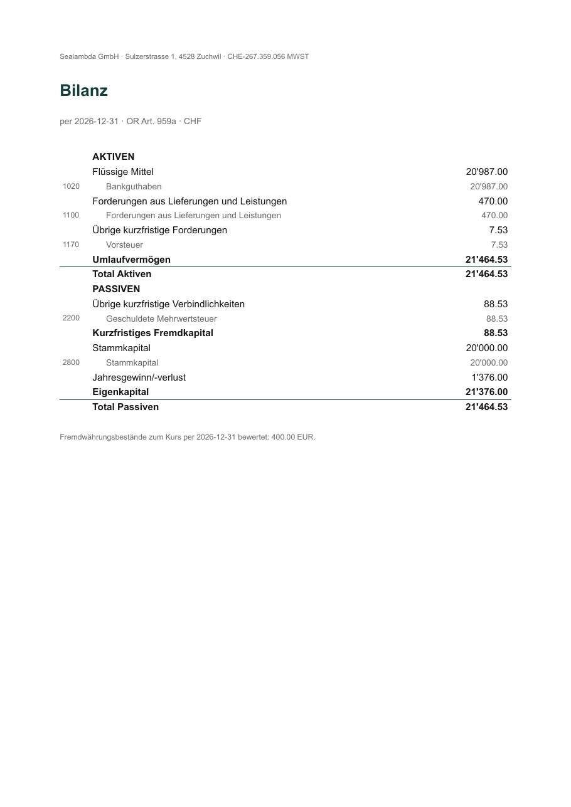

# Statutory reports

The balance sheet and income statement your Treuhänder, the tax office and,
for a GmbH or AG, the shareholders' meeting need, grouped the way the law
lays them out.[^structure] quints groups your accounts by the `kmu:` codes
on their `open` directives, which is why `quints check` insists on the
codes.

!!! abstract "Applies if"
    - **Legal form:** Einzelfirma, GmbH or AG. The equity section is labelled
      for the form: Eigenkapital, Stammkapital or Aktienkapital.
    - **VAT status:** any. VAT balances appear as receivables or liabilities
      like any other.
    - **Fiscal year:** the calendar year, or a GmbH's or AG's extended first
      year (`--from`, see [Close the year](year-end.md#an-extended-first-year)).
    - **Not covered:** consolidated accounts, the notes to the accounts
      (Anhang, Art. 959c OR), a cash-flow statement, and the larger
      companies' additional reporting (Art. 961 ff. OR).

## Balance sheet and income statement

```bash
quints report bilanz --at 2026-12-31
quints report erfolg --year 2026
```

`bilanz` values non-CHF balances at the report-date rate (same method Fava
uses, so totals tie out) and splits the balancing figure into
Gewinnvortrag and the fiscal year's result. Part of that result is
unrealised FX: the report-date value of the foreign balances less what they
were booked at. `bilanz` prints it (`unrealized_fx` in `--json`) until the
[revaluation](fx.md) books it. The fiscal year starts on
1 January of the `--at` year; `--from` moves the start for an
[extended first year](year-end.md#an-extended-first-year). `erfolg` converts
flows at each transaction's date and takes `--from`/`--to` for any period.

The equity section is labeled for your [legal form](../legal-forms.md):
Eigenkapital, Stammkapital, or Aktienkapital.

The rows follow the minimum structure the law sets, in its order.[^structure]
They are filled from the KMU Kontenrahmen classes:[^kmu]

| Rows | KMU codes |
| --- | --- |
| Nettoerlöse; Bestandesänderungen | 3000–3899; 3900–3999 |
| Material, Personal, übriger betrieblicher Aufwand, Abschreibungen | 4, 5, 6000–6799, 6800–6899 |
| Finanzaufwand / Finanzertrag | 6900–6949 / 6950–6999 |
| Betrieblicher Nebenerfolg | 7000–7999 |
| Betriebsfremder Aufwand / Ertrag | 8000–8099 / 8100–8199 |
| Ausserordentlicher, einmaliger oder periodenfremder Aufwand / Ertrag | 8500–8509 / 8510–8599 |
| Direkte Steuern | 8900–8999 |

The income statement shows the rows after the financial result, with their
subtotals, only when your books use them. On the balance sheet, Beteiligungen
(1480–1499), nicht einbezahltes Kapital (1800–1899), the reserves (2900,
2950, 2955 Aufwertungsreserve, 2960) and eigene Kapitalanteile (2965, as a
minus item) each have their own row. Together they make the `reserves`
subtotal (2900–2969, own shares included), the same figure the single
reserves row showed before. In `--json` it stays the `reserves` row of
`equity`, with the positions under `parts`. Totals count it once.

Two checks keep the statements honest:

- **A code in no row** (for example 8300, 1950 or 2750) is listed under
  the statement with its amount, never dropped.
- **The two results agree.** The balance sheet's result must equal the
  income statement's result plus the unrealised FX, plus whatever
  beancount's balancing tolerance left in the books (a conversion like
  `100 EUR @ 0.93127 CHF` booked against 93.13 CHF). If it doesn't, the
  balance sheet lists the gap. The usual cause is an account the income
  statement can't see: one without a `kmu:` code, or with a code in no row.

## Auditor detail

```bash
quints report konten --year 2026
```

Kontoblätter: per-KMU-code transaction listings — every booking behind every
statement line. This is what your Treuhänder asks for when a number looks off.

## The PDF for your Treuhänder

```bash
quints report statements --year 2026 --lang de
```

Bilanz + Erfolgsrechnung as one PDF, in German (`--lang de`) or English,
with your issuer identity from `invoicing/issuer.yaml` on it. `--out` picks
the path. Both statements cover the same fiscal year: `--from` (default
1 January) to `--at` (default 31 December).

What the law asks of the annual accounts, and what the PDF does about it:

- **Prior-year figures.** Each statement carries a second column with the
  previous calendar year's figures.[^prior] A first year has none: with
  `--from` (an [extended first year](year-end.md#an-extended-first-year)),
  or when nothing was booked the year before, the column is left out and
  `report statements` says so. Moved your books to quints mid-life? Date
  the opening-balance entry 31 December of the year before instead of
  1 January, and the Bilanz column has that year's closing figures. After
  an extended first year, the next year's comparative column covers only the
  calendar year before it, not the whole first period.
- **Signatures.** The last page has lines for place and date, the chair of
  the management body, and the person responsible for the financial
  reporting.[^sign] In an Einzelfirma the owner signs both. A GmbH's
  managing director, or an AG's board chair, signs the first.
- **The notes (Anhang).** Not included, and the PDF says so. You write them
  separately (see [below](#what-quints-doesnt-do-here)).

The PDF is PDF/A-2b, the archival format, so it stays readable for the ten
years you keep it ([Close the year](year-end.md#keep-the-books-for-ten-years)).

{ width="480" }

All report commands take `--lang` and `--json`.

If the ledger doesn't load cleanly (a mistyped `include`, a syntax error, a
failing `balance` assertion), every report still renders and lists the
errors under its figures, and in `--json` under `violations`. The PDF lists
them in a box at the top of the first page. The statements are incomplete
until you fix them.

Before the statements are final, run the year-end checklist:
[Close the year](year-end.md).

## What quints doesn't do here

- **The Anhang (notes).** Every company with full bookkeeping needs one:
  a GmbH, an AG, and an Einzelfirma above CHF 500'000 turnover.[^anhang]
  Write it with your Treuhänder. The Kontoblätter (`quints report konten`)
  are the detail behind it.
- **Profit appropriation** and the shareholders' approval (GmbH/AG).
- **The tax return.** The statements are its input, not the return.

[^kmu]: Schweizer Kontenrahmen KMU, [Schulkontenrahmen KMU (SwissAccounting)](https://www.kmu.admin.ch/dam/de/sd-web/Q2HAXEngBfiW/schulkontenrahmen-kmu.pdf): classes 7 (Betrieblicher Nebenerfolg: 7000/7010, 7500/7510) and 8 (8000, 8100, 8500, 8510, 8900), and the Gesamtkostenverfahren layout on its last page.
[^structure]: Minimum structure of the balance sheet and income statement: Art. 959a and 959b OR, [SR 220](https://www.fedlex.admin.ch/eli/cc/27/317_321_377/de#art_959_a). Art. 959b Abs. 2 lists the income statement's positions, "8. betriebsfremder Aufwand und betriebsfremder Ertrag; 9. ausserordentlicher, einmaliger oder periodenfremder Aufwand und Ertrag; 10. direkte Steuern" among them. The Aufwertungsreserve is shown "unter der gesetzlichen Gewinnreserve gesondert" (Art. 725c Abs. 1 OR). The account codes follow the Schweizer Kontenrahmen KMU, edition 2023 ([SwissAccounting](https://swissaccounting.org/kontenrahmen)).
[^prior]: Art. 958d Abs. 2 OR: "In der Jahresrechnung sind neben den Zahlen für das Geschäftsjahr die entsprechenden Werte des Vorjahres anzugeben." [fedlex](https://www.fedlex.admin.ch/eli/cc/27/317_321_377/de#art_958_d).
[^sign]: Art. 958 Abs. 3 OR: the Geschäftsbericht is signed "vom Vorsitzenden des obersten Leitungs- oder Verwaltungsorgans und der innerhalb des Unternehmens für die Rechnungslegung zuständigen Person". [fedlex](https://www.fedlex.admin.ch/eli/cc/27/317_321_377/de#art_958).
[^anhang]: Art. 958 Abs. 2 OR (the annual accounts are the Bilanz, the Erfolgsrechnung and the Anhang) and Art. 959c OR (its contents). Art. 957 Abs. 2 OR exempts the Einzelunternehmen below CHF 500'000 turnover, which may keep simplified accounts. [fedlex](https://www.fedlex.admin.ch/eli/cc/27/317_321_377/de#art_957).
